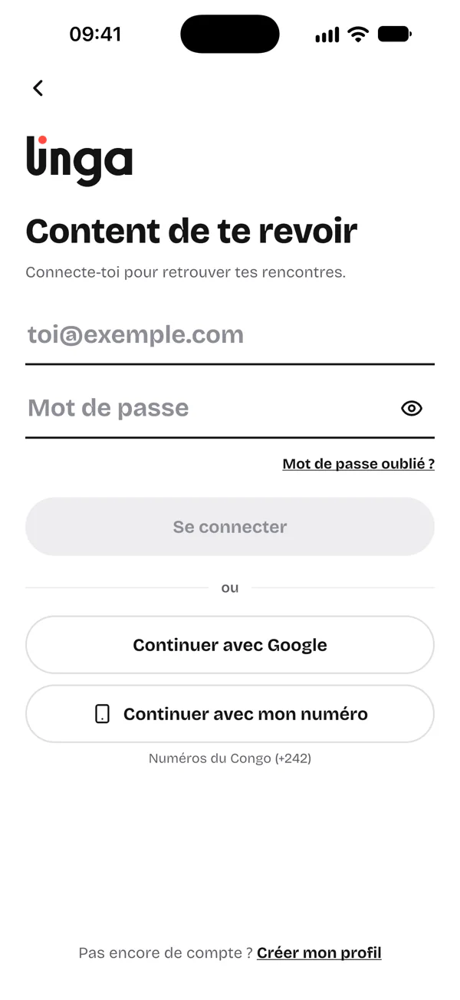
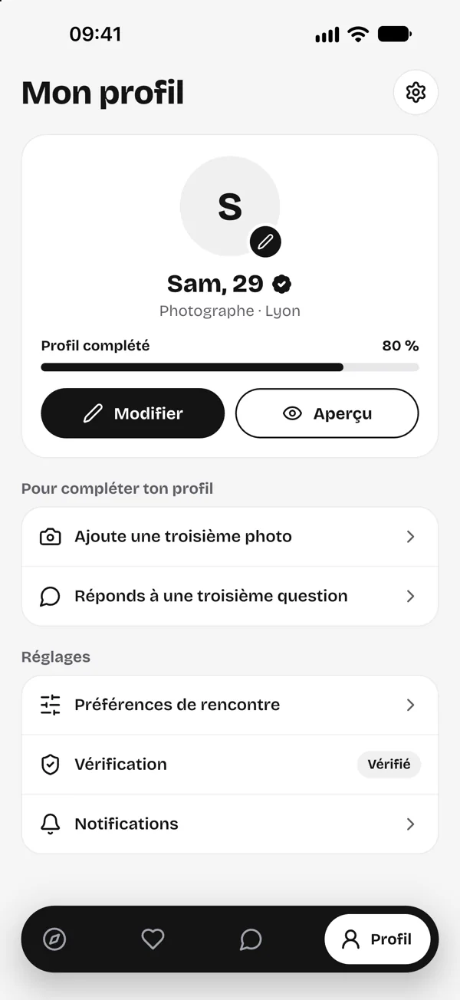

# Contrat des pages du site Linga

Ce document fixe comment s'écrit une page du site. Le design (CSS, en-tête, pied, haut des pages) et le contenu des
pages sont faits séparément : une page de contenu n'utilise que les éléments décrits ici.

## Arborescence

| Chemin | Contenu |
|---|---|
| `build.py` | Assemble `src/pages/**/*.html` dans `_site/` (sans dépendance : Python 3 seul) |
| `captures.py` | Refait les captures d'écran de l'app (`assets/img/app/`) depuis le simulateur iOS : voir « Captures d'écran de l'app » |
| `captures/visages/` | Photos d'illustration des profils de démonstration, servies au test pendant les captures, jamais publiées telles quelles (`SOURCES.md`) |
| `src/layout.html` | Squelette commun : `<head>`, en-tête, pied de page |
| `src/pages/` | Une page par fichier, avec son en-tête (voir plus bas) |
| `assets/` | `css/linga.css`, `js/linga.js`, `fonts/`, `img/` (`logo/`, `icons.svg`, `app/` : les captures d'écran) : copiés dans `_site/assets/` |
| `static/` | Fichiers copiés à la racine de `_site/` (favicons, `og-image.png` : image de partage 1200 × 630) |
| `_site/` | Le site construit (ignoré par git) |

`build.py` écrit aussi `_site/sitemap.xml` et `_site/robots.txt`, avec l'adresse publique du site (voir
« Construction »).

Adresses propres : `src/pages/cgu.html` donne `_site/cgu/index.html` (adresse `/cgu/`), `src/pages/aide/connexion.html`
donne `_site/aide/connexion/index.html`. `index.html` donne `_site/index.html`, `404.html` donne `_site/404.html`.

## Les pages

| Adresse | Source | Layout |
|---|---|---|
| `/` | `index.html` | `landing` |
| `/securite/` | `securite.html` | `page` |
| `/aide/` | `aide/index.html` | `page` |
| `/aide/connexion/` | `aide/connexion.html` | `help` |
| `/aide/verification/` | `aide/verification.html` | `help` |
| `/aide/signaler-bloquer/` | `aide/signaler-bloquer.html` | `help` |
| `/aide/abonnement/` | `aide/abonnement.html` | `help` |
| `/contact/` | `contact.html` | `page` |
| `/cgu/` | `cgu.html` | `legal` |
| `/cgv/` | `cgv.html` | `legal` |
| `/confidentialite/` | `confidentialite.html` | `legal` |
| `/mentions-legales/` | `mentions-legales.html` | `legal` |
| `/suppression-du-compte/` | `suppression-du-compte.html` | `legal` |
| `/conditions/` | `conditions.html` | `redirect` vers `/cgu/` (adresse déjà donnée par l'app) |
| `/404.html` | `404.html` | `page` |

## En-tête d'une page source

Un commentaire HTML en toute première ligne, une clé par ligne :

```html
<!--
title: Conditions générales d'utilisation
description: Les règles de Linga : qui peut l'utiliser, ce qui est interdit, la modération. (160 caractères au plus)
layout: legal
eyebrow: Informations légales
title_html: Conditions générales <span class="muted">d'utilisation</span>
lead: Une phrase sous le titre.
updated: 8 novembre 2026
draft: true
cta_label: Nos conseils de sécurité
cta_href: /securite/
redirect: /cgu/
-->
<h2 id="objet">Article 1 – Objet</h2>
<p>…</p>
```

- `title`, `description`, `layout` : obligatoires. Une clé inconnue (ou mal écrite : `Draft`, `drafts`) ou donnée deux
  fois fait échouer la construction.
- `description` : 160 caractères au plus.
- `eyebrow` : la pastille au-dessus du titre (layouts `page` et `legal` ; sur `help`, le fil d'Ariane la remplace).
- `title_html` : le titre affiché, si sa fin doit être grisée (`<span class="muted">`) ; sinon `title`.
- `lead` : la phrase sous le titre (layouts `page`, `legal`, `help`).
- `updated` : « Dernière mise à jour » (layouts `legal`, `help`).
- `draft: true` : bandeau « Projet à faire valider par un juriste avant publication » en tête du contenu, et
  `noindex` pour les moteurs de recherche. Seules valeurs admises : `true` ou `false` (sinon, erreur).
- `cta_label`, `cta_href` : un bouton sous le titre (layout `page`).
- `redirect` : seulement pour `layout: redirect`, le chemin du site vers lequel renvoyer (commence par `/`).

## Les liens

Toujours des chemins absolus depuis la racine du site, avec la barre finale : `/cgu/`, `/aide/connexion/`,
`/confidentialite/#durees`, `/assets/img/icons.svg#shield-check`. `build.py` les rend relatifs : le site marche à
n'importe quelle adresse (`https://linga.chat/` comme un aperçu servi dans un sous-dossier).
Liens externes : `https://…` ; e-mail : `mailto:aide@linga.chat`.

## Les layouts

- **legal** : `build.py` affiche le haut de page (pastille, titre, « Dernière mise à jour », et sur ces quatre
  documents seulement, les onglets CGU · CGV · Confidentialité · Mentions légales), puis deux colonnes : à gauche le sommaire, construit tout seul à partir des
  `<h2 id="…">` du corps ; à droite le corps, dans une carte. Le corps ne contient que du **texte** (voir plus bas).
- **help** : fil d'Ariane (Aide › titre) à la place de la pastille, haut de page, sommaire et carte de contenu comme `legal`, puis un encadré
  « Encore une question ? » ajouté par `build.py`. Le corps ne contient que du **texte**.
- **page** : haut de page rendu par `build.py` (pastille, titre, phrase, bouton facultatif) ; le corps est fait de
  **sections**.
- **landing** : le corps contient toute la page, sections comprises (l'accueil).
- **redirect** : page vide qui renvoie vers `redirect` (balise `meta refresh` et lien).

## Texte (layouts legal et help)

- Titres : `<h2 id="mot-cle">Article 1 – Objet</h2>` (id en minuscules, sans accent, mots reliés par des tirets ;
  unique dans la page), puis `<h3>`.
- `<p>`, `<ul>`, `<ol>`, `<strong>`, `<em>`, `<a href="…">`.
- Tableau : `<div class="table-wrap"><table><thead>…</thead><tbody>…</tbody></table></div>`, toujours avec un
  `<thead>` (un titre par colonne, sans `colspan`) et précédé d'un `<h2>` ou `<h3>`. `build.py` complète tout seul :
  nom de la zone (« Tableau : » + ce titre) pour le clavier et les lecteurs d'écran, et titre de colonne sur chaque
  cellule (`data-label`). Sur téléphone, un tableau de trois colonnes ou plus s'affiche en fiches empilées (la
  première cellule en titre, les autres précédées du titre de leur colonne) ; à deux colonnes, il tient dans la
  largeur. Ne rien écrire de tout cela à la main.
- Passage à compléter : `<mark class="todo">[à compléter : raison sociale]</mark>`.
  Sur les pages publiques (aide, contact, sécurité, accueil), pas de marque visible : une note
  `<!-- à compléter : … -->` (ou `à valider`, `à vérifier`), que `build.py` retire du site construit.
- Encadré : `<div class="callout"><p>…</p></div>` ; important : `<div class="callout callout--accent"><p>…</p></div>`.
- Définitions : `<dl class="definitions"><dt>Terme</dt><dd>Définition.</dd></dl>`.
- Étapes à suivre dans l'app : `<ol class="steps"><li>…</li></ol>`.
- Chemin dans l'app : `<span class="path">Réglages › Confidentialité › Télécharger mes données</span>` (texte seul,
  étapes séparées par « › ») : `build.py` ne laisse la ligne se couper qu'entre deux étapes.
- Capture d'écran de l'app (layout `help`) : une ou deux figures dans `<div class="captures">`, côte à côte quand la
  place le permet. Écran sombre (accueil, « Ton profil est vérifié ») : `capture capture--sombre`.
  ```html
  <div class="captures">
    <figure class="capture">
      
      <figcaption>Après « J'ai déjà un compte ».</figcaption>
    </figure>
  </div>
  ```
  `alt` dit ce que montre l'écran (ce qu'en retiendrait quelqu'un qui ne le voit pas), la légende dit à quoi il sert
  ici : ne pas répéter l'un dans l'autre. Pas de lien vers l'image seule : le zoom du navigateur suffit.

## Sections (layouts page et landing)

- Section : `<section class="section" id="…"><div class="container">…</div></section>` ; plus serrée :
  `section section--tight`.
- En-tête de section : `<span class="eyebrow">Les bons réflexes</span>`, puis
  `<h2 class="display">Première ligne <span class="muted">deuxième ligne.</span></h2>`, puis `<p class="lead">…</p>`.
  Centré : ajouter `section__head--center` sur un `<div class="section__head">` qui les entoure.
- Deux colonnes (texte à gauche, contenu à droite) : `<div class="split"><div>…</div><div>…</div></div>`.
- Cartes : `<div class="cards cards--3">` (ou `cards--2`, `cards--4`) contenant des
  `<article class="card"><span class="card__icon"><svg class="icon" aria-hidden="true"><use href="/assets/img/icons.svg#shield-check"></use></svg></span><h3>Titre</h3><p>Texte.</p></article>`.
  Carte-lien : `<a class="card card--link" href="/aide/connexion/">…<span class="card__more">Lire l'article</span></a>`.
- Règles numérotées : `<ol class="rules"><li><p>…</p></li></ol>` (cartes au numéro coquelicot).
- Questions fréquentes : `<div class="faq"><details><summary>La question ?</summary><div class="faq__answer"><p>La réponse.</p></div></details></div>`.
- Liste à coches : `<ul class="checklist"><li>…</li></ul>`.
- Boutons : `<a class="button button--light" href="…">Libellé</a>` (blanc), `<a class="button button--ghost" href="…">`
  (contour), `<a class="button button--accent" href="…">` (coquelicot, texte noir).
- Pastille « Bientôt » (fonction pas encore disponible) : `<span class="tag">Bientôt</span>`, coquelicot, texte
  noir ; dans le coin d'une carte : `<span class="tag tag--corner">Bientôt</span>`. Un seul style sur tout le site.
- Badges des boutiques : `<span class="store">…</span>` dans `<div class="stores">`, volontairement d'aspect inactif
  (contour pointillé) tant que l'app n'est pas sortie ; ils deviendront des liens blancs avec les adresses des boutiques.
- Encadré de contact : `<div class="contact-card"><span class="card__icon">…</span><div><p class="contact-card__label">…</p><p class="contact-card__value">…</p></div></div>`.
- Téléphone (accueil) : un cadre autour d'une capture de l'app, dans un conteneur `aria-hidden="true"` quand le
  texte voisin dit déjà ce que montre l'écran (alors `alt=""`) :
  ```html
  <div class="phone">
    <div class="phone__screen">
      
      <span class="phone__island"></span>
      <span class="phone__home"></span>
    </div>
  </div>
  ```
  `--w` règle la largeur du cadre, 290 px par défaut (`sizes` : `--w` moins 20 px, donc 270px ici ; 290px pour le
  téléphone du haut de l'accueil, où `--w` vaut 310 px) ; écran sombre : `phone phone--sombre` (barre
  d'accueil claire). Le téléphone de « Comment ça marche » change d'image au défilement : une `phone__shot` par étape,
  avec `data-screen="0"`, `"1"`… La première image visible sans défiler prend `fetchpriority="high"` au lieu de
  `loading="lazy"`.

## Icônes

Un seul fichier, `assets/img/icons.svg` : des symboles de 24 × 24, au trait (`stroke="currentColor"`, épaisseur 1,8,
bouts ronds). Noms disponibles :

`shield-check`, `map-pin`, `image`, `flag`, `bell`, `moon`, `lock`, `user`, `users`, `heart`, `message`, `mic`,
`calendar`, `pause`, `eye-off`, `check`, `x`, `plus`, `arrow-right`, `arrow-up-right`, `chevron-down`, `mail`,
`phone`, `smartphone`, `key`, `alert`, `help`, `sparkles`, `download`, `trash`, `file-text`, `globe`, `star`,
`camera`, `sliders`, `log-in`, `credit-card`, `clock`.

```html
<svg class="icon" aria-hidden="true"><use href="/assets/img/icons.svg#heart"></use></svg>
```

## Le ton

Français, tutoiement, sans emoji, phrases courtes. Écrire normalement l'espace avant « : ; ? ! » : `build.py` la rend
insécable (y compris dans `<strong>Important </strong>:`), et empêche « e-mail » et « Écris-nous » de se couper au trait d'union. Un chemin court (26 signes au plus,
« Profil › Vérification ») ne se coupe jamais. Pas de
photo de personne sur le site, sauf dans les captures de l'app : les visages des profils de démonstration y sont
des photos d'illustration (`captures/visages/`, voir `SOURCES.md`), et le pied de page dit que ces personnes ne
sont pas des membres de Linga.

## Captures d'écran de l'app

De vraies captures du simulateur iOS, jamais des écrans redessinés. Les profils de démonstration n'ont pas de photo
dans l'app : pendant les captures, `captures.py` sert au test les photos de `captures/visages/`, que l'app affiche à
la place des initiales (`lingaStandInPhoto`, réglé par le test seulement). Le test d'intégration de l'app
(`../app/integration_test/captures_site_test.dart`) lance l'app en démonstration (données des maquettes, heure figée
à 9 h 41), va d'écran en écran et demande une capture à `captures.py` à chaque écran à garder ; la barre d'état est
figée pendant ce temps (« 09:41 » sur un simulateur en français, réseau et batterie pleins).

```
python3 captures.py --simulateur <UDID>               # toutes les captures, puis les images du site
python3 captures.py --simulateur <UDID> --png DOSSIER # garde aussi les PNG d'origine (1320 × 2868)
```

- Chaque écran donne trois images, `assets/img/app/<nom>-300.webp`, `-600.webp` et `-900.webp` (1x, 2x et 3x d'un
  écran affiché sur environ 300 px, en 300 × 652, 600 × 1304 et 900 × 1955), toujours dans `srcset`, avec
  `width="600" height="1304"`. Elles sont écrites d'un coup, une fois toutes converties.
- Seuls les écrans que les pages utilisent deviennent des images ; les autres fichiers de `assets/img/app/` sont
  retirés. Un écran utilisé par une page mais que le test ne capture pas arrête tout.
- Captures d'iPhone Pro Max (1320 × 2868, simulateur « iPhone 18 Pro Max ») : le cadre `.phone` en a les proportions,
  et l'île et la barre d'accueil, que les captures ne montrent pas, y sont dessinées à leur place. Une capture d'une
  autre taille arrête `captures.py`. À la fin, `flutter test` désinstalle l'app du simulateur.
- Nouvel écran : l'ajouter au test de l'app (`capture(tester, 'nom')`), puis l'utiliser dans une page et relancer
  `captures.py`.
- Une capture montre l'app telle qu'elle est : si un texte de l'app contredit le site (fonction, prix, délai), corriger
  l'un ou l'autre avant de la publier.

## Construction

```
python3 build.py                                    # strict : la moindre erreur ou le moindre avertissement arrête tout
python3 build.py --no-strict                        # essai : les avertissements n'arrêtent plus (jamais pour publier)
python3 build.py --site-url https://exemple.org/linga --root-path /linga/  # site servi dans un sous-dossier
```

- Strict par défaut : description de plus de 160 caractères, `<h2>` sans id (absent du sommaire), id mal formé, clé
  d'en-tête inconnue, `draft` autre que `true`/`false`, fichier qui n'est pas en UTF-8 : rien n'est écrit.
- Contrôlé aussi : aucun `style=`, `<style>`, script en ligne, ni ressource chargée depuis un autre site (`src`,
  `<link href>`, `<use href>`… en `https://` ou `//`) : la CSP les bloquerait. Seuls les liens `<a href>` et la
  balise canonique peuvent viser un autre site.
- Chaque `` a un `alt` (vide pour une image qui ne fait que décorer), `width` et `height` en pixels (la place
  est réservée avant le chargement : rien ne saute), et `sizes` si elle a un `srcset`. Les adresses de `srcset` sont
  vérifiées et rendues relatives comme les autres.
- `--site-url` (ou `LINGA_SITE_URL`, défaut `https://linga.chat`) : adresse publique, utilisée pour les adresses
  canoniques, `og:url`, `og:image`, `sitemap.xml` et `robots.txt`. Les valeurs par défaut sont celles de
  `https://linga.chat`, servi par Cloudflare à la racine (voir README.md, « Publication ») ; `robots.txt` n'est lu par
  les robots qu'à la racine d'un hôte.
